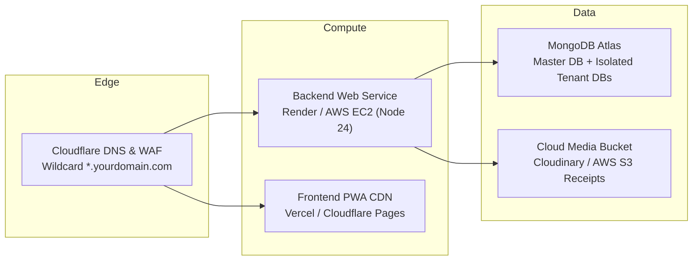
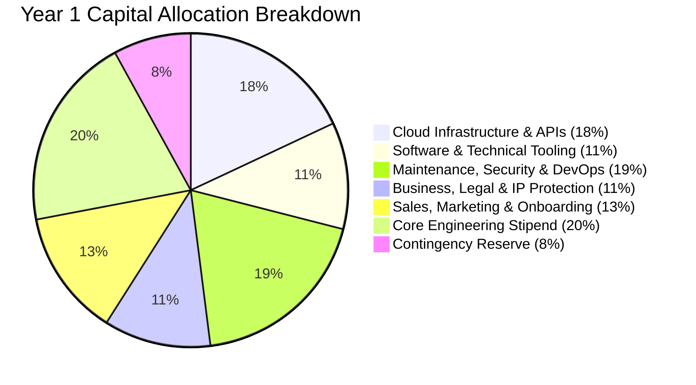

# Financial Plan & Operational Budget Breakdown
### **Dine — Multi-Tenant Restaurant SaaS Platform Suite**

---

## Executive Summary & Funding Snapshot

This financial report outlines the projected capital requirements, recurring infrastructure overhead, operational expenses, and unit economics for **Dine**—a hybrid multi-tenant restaurant SaaS platform utilizing database-per-tenant MongoDB Atlas isolation, React PWA storefronts, in-memory SQLite acceleration, and integrated localized payment workflows (GCash, Maya, QR Ph, Card).

```
┌────────────────────────────────────────────────────────────────────────┐
│                        FUNDING TARGET SNAPSHOT                         │
├───────────────────────────────┬───────────────────┬────────────────────┤
│ Category                      │ PHP (₱)           │ USD ($ equiv.)     │
├───────────────────────────────┼───────────────────┼────────────────────┤
│ Phase 1: MVP to Launch Runway │ ₱ 350,000         │ $ 6,250            │
│ Phase 2: 12-Month Scale & Run │ ₱ 1,200,000       │ $ 21,400           │
│ Recommended Seed Ask (12-Mo)  │ ₱ 1,500,000       │ $ 26,800           │
│ Estimated Gross Margin        │ 82% – 88%         │                    │
│ Target Break-Even Tenant Count│ 28 – 35 Paying Bistros (Growth Tier)   │
└───────────────────────────────┴───────────────────┴────────────────────┘
```

---

## 1. Development Costs (Software, Tooling & Capital Outlay)

Development expenditures encompass tooling licenses, testing environments, and capital assets required by the engineering team before and during launch.

| Item / Resource | Description | Type | Cost (PHP) | Cost (USD) | Frequency |
| :--- | :--- | :--- | :--- | :--- | :--- |
| **Developer Hardware & Test Devices** | Low-cost Android & iOS test devices, dedicated thermal receipt printers (ESC/POS 58mm/80mm), tablet for KDS testing | One-Time | ₱ 45,000 | $ 800 | Initial Setup |
| **IDE & Development Tooling** | JetBrains WebStorm / VS Code Pro extensions, Cursor / GitHub Copilot seats (2 devs) | Recurring | ₱ 2,240 / mo | $ 40 / mo | ₱ 26,880 / yr |
| **API Testing & Mocking** | Postman Team workspace (collaborative API collection testing for `/api/tenant`, `/api/storefront`) | Recurring | ₱ 1,680 / mo | $ 30 / mo | ₱ 20,160 / yr |
| **Design & Prototyping** | Figma Professional (UI/UX design system, glassmorphism tokens, and mobile customer flow mockups) | Recurring | ₱ 840 / mo | $ 15 / mo | ₱ 10,080 / yr |
| **Code Repository & CI/CD** | GitHub Team tier (Protected branches, CI/CD automated build minutes, artifact storage) | Recurring | ₱ 450 / mo | $ 8 / mo | ₱ 5,400 / yr |
| **SSL & Code Signing Certificates** | Wildcard SSL for `*.dine.ph` / `*.restosaas.com` (Cloudflare edge handles free tier; enterprise backup cert) | Recurring | ₱ 4,500 / yr | $ 80 / yr | ₱ 4,500 / yr |
| **Subtotal Development Costs** | | | **₱ 45,000 One-time + ₱ 67,020 / yr** | **$ 800 One-time + $ 1,173 / yr** | |

---

## 2. Domain, Hosting & Cloud Infrastructure

The Dine architecture uses **physical database-per-tenant isolation** on MongoDB Atlas paired with Node.js in-memory caching and containerized application execution (Render / AWS ECS / Vercel).



### Detailed Infrastructure Cost Schedule

| Component | Provider & Tier | Purpose | Cost (PHP / mo) | Cost (USD / mo) | Annual Cost (PHP) |
| :--- | :--- | :--- | :--- | :--- | :--- |
| **Primary Domain Name** | Namecheap / Porkbun (`.com` or `.ph`) | Brand Identity & Wildcard Subdomains | ₱ 150 / mo *(amortized)* | $ 2.70 / mo | ₱ 1,800 / yr |
| **DNS, CDN & WAF** | Cloudflare Pro | Wildcard SSL for dynamic tenant subdomains (`tenant.yourdomain.com`), DDoS mitigation, edge caching | ₱ 1,400 / mo | $ 25 / mo | ₱ 16,800 / yr |
| **Backend API Server** | Render Starter / Standard (or AWS Lightsail 4GB RAM) | Express 5 server, handles in-memory SQLite and REST endpoints | ₱ 1,400 / mo | $ 25 / mo | ₱ 16,800 / yr |
| **PWA Static Hosting** | Vercel Pro / Cloudflare Pages | Customer Storefront PWA, Tenant Portal, and Super Admin SPA delivery | ₱ 1,120 / mo | $ 20 / mo | ₱ 13,440 / yr |
| **Database Cluster** | MongoDB Atlas M10 / M20 Cluster | Dedicated RAM, automated daily snapshots, supporting 50–200 tenant isolated databases | ₱ 4,480 / mo | $ 80 / mo | ₱ 53,760 / yr |
| **Cloud Object Storage** | Cloudinary Plus or AWS S3 + CloudFront | Dish photos, logo branding, and customer GCash/Maya receipt screenshots | ₱ 1,400 / mo | $ 25 / mo | ₱ 16,800 / yr |
| **Redis Cache / Job Queue** | Upstash / Redis Cloud (Free/PayG) | Shared rate limiting, live socket broadcasting | ₱ 560 / mo | $ 10 / mo | ₱ 6,720 / yr |
| **Subtotal Hosting & Cloud** | | | **₱ 10,510 / mo** | **$ 187.70 / mo** | **₱ 126,120 / yr** |

---

## 3. Third-Party Services & Integrations

Core platform features rely on specialized third-party APIs for financial settlement, real-time messaging, and notifications.

| Integration | Provider | Function | Pricing Structure | Est. Cost (PHP / mo) | Est. Cost (USD / mo) |
| :--- | :--- | :--- | :--- | :--- | :--- |
| **Payment Gateway** | PayMongo / Xendit / Maya Business | Automated checkout for GCash, Maya, GrabPay, and Credit Cards | 1.5% to 2.9% + ₱15 per transaction *(passed through or deducted from merchant)* | ₱ 0 direct SaaS cost *(Transaction fees borne by merchant or fee split)* | $ 0 |
| **SMS Notifications** | Semaphore (PH) / Twilio | Order status updates (`Ready for pickup`), staff alerts, 2FA OTPs | ₱ 0.50 – ₱ 0.60 per SMS (~3,000 SMS/mo across 20 stores) | ₱ 1,800 / mo | $ 32 / mo |
| **Transactional Email** | Resend / SendGrid (Essentials) | Tenant billing invoices, password resets, onboarding invitations | ₱ 1,120 / mo (up to 50,000 emails/mo) | ₱ 1,120 / mo | $ 20 / mo |
| **Error Monitoring & APM** | Sentry Developer / Team | Real-time frontend and backend crash reporting and telemetry | ₱ 1,450 / mo | ₱ 1,450 / mo | $ 26 / mo |
| **Subtotal Third-Party Services**| | | | **₱ 4,370 / mo** | **$ 78 / mo** |

---

## 4. Operational Subscriptions & Workspace Software

Team productivity, internal communication, and administrative subscriptions.

| Platform | Tier | Purpose | Monthly Cost (PHP) | Annual Cost (PHP) |
| :--- | :--- | :--- | :--- | :--- |
| **Google Workspace** | Business Starter (3 seats) | Custom domain emails (`admin@dine.ph`, `support@...`, `billing@...`), Drive cloud storage | ₱ 1,008 / mo | ₱ 12,096 / yr |
| **Customer Support / Helpdesk**| Crisp Chat or Freshdesk Starter | Real-time support widget on Super Admin and Tenant Portals | ₱ 1,400 / mo | ₱ 16,800 / yr |
| **Password & Secrets Management**| 1Password / Bitwarden Teams | Secure sharing of database credentials, master secrets, and API keys | ₱ 560 / mo | ₱ 6,720 / yr |
| **Subtotal Workspace Subscriptions** | | | **₱ 2,968 / mo** | **₱ 35,616 / yr** |

---

## 5. Maintenance, Security & Support

Running an uptime-critical food service platform demands robust backup strategies, periodic penetration testing, and incident response.

| Maintenance Item | Scope & Responsibilities | Frequency | Estimated Cost (PHP) | Estimated Cost (USD) |
| :--- | :--- | :--- | :--- | :--- |
| **Database Automated Backups** | Continuous automated snapshots, cross-region replication for tenant databases | Monthly | ₱ 1,500 / mo (₱ 18,000 / yr) | $ 27 / mo ($ 320 / yr) |
| **Security Auditing & Pen Testing**| Vulnerability scans, dependency auditing (`npm audit`), injection testing | Bi-annual | ₱ 30,000 / yr | $ 535 / yr |
| **On-Call & Server Administration**| Server monitoring, database optimization, disk cleanup, patch updates | Monthly | ₱ 10,000 / mo (₱ 120,000 / yr) | $ 180 / mo ($ 2,140 / yr) |
| **Emergency Contingency Reserve** | Unplanned infrastructure surges or burst compute during peak holiday dining seasons | Annual reserve | ₱ 25,000 / yr | $ 450 / yr |
| **Subtotal Maintenance & Support** | | | **₱ 193,000 / yr** | **$ 3,445 / yr** |

---

## 6. Business, Legal, Marketing & Miscellaneous

Essential non-technical expenditures necessary to legitimize operations, attract initial restaurant clients, and maintain compliance.

| Expense Category | Details | Type | Cost (PHP) | Cost (USD) |
| :--- | :--- | :--- | :--- | :--- |
| **Business Registration & Compliance** | DTI / SEC Registration, Barangay Clearance, Mayor's Permit, BIR 2303 registration | One-Time | ₱ 25,000 | $ 450 |
| **Data Privacy & Legal Counsel** | Privacy Policy & Terms of Service tailored to Philippine Data Privacy Act (DPA of 2012) & merchant agreements | One-Time | ₱ 20,000 | $ 360 |
| **Trademark Registration** | IPOPHL Trademark application for Dine brand and logo | One-Time | ₱ 8,500 | $ 150 |
| **Merchant Acquisition & Pilot Marketing**| On-site QR standee printing, promotional flyers, direct sales visits to local food parks and restaurants | One-Time / Pilot | ₱ 50,000 | $ 900 |
| **Banking & Corporate Account Fees** | Bank transaction fees, corporate maintaining balances | Ongoing | ₱ 6,000 / yr | $ 110 / yr |
| **Subtotal Business & Other Costs** | | | **₱ 103,500 One-time + ₱ 6,000 / yr** | **$ 1,860 One-time + $ 110 / yr** |

---

## 7. Master Cost Consolidation Table

The combined financial baseline across all six categories for **Year 1 (Initial Build + 12-Month Operations)**:

| Expense Category | One-Time Setup (PHP) | Monthly Recurring (PHP) | Total Year 1 (PHP) | Total Year 1 (USD) | % of Total Budget |
| :--- | :--- | :--- | :--- | :--- | :--- |
| **1. Development & Software** | ₱ 45,000 | ₱ 5,585 | ₱ 112,020 | $ 2,000 | 12.4% |
| **2. Domain & Hosting** | — | ₱ 10,510 | ₱ 126,120 | $ 2,250 | 14.0% |
| **3. Third-Party Services** | — | ₱ 4,370 | ₱ 52,440 | $ 935 | 5.8% |
| **4. Subscriptions & Tooling** | — | ₱ 2,968 | ₱ 35,616 | $ 635 | 4.0% |
| **5. Maintenance & Support** | ₱ 25,000 | ₱ 14,000 | ₱ 193,000 | $ 3,445 | 21.4% |
| **6. Business, Legal & Marketing** | ₱ 103,500 | ₱ 500 | ₱ 109,500 | $ 1,955 | 12.2% |
| **Personnel / Engineering Stipend** | — | ₱ 23,500 *(Dev runway)* | ₱ 282,000 | $ 5,035 | 31.3% |
| **Contingency Buffer (10%)** | — | — | ₱ 91,070 | $ 1,625 | 8.9% |
| **GRAND TOTAL (Year 1 Runway)**| **₱ 173,500** | **₱ 60,933 / mo** | **₱ 1,001,766** | **$ 17,875** | **100%** |

*(Figures rounded for pitch clarity; currency exchange baseline: $1.00 USD ≈ ₱56.00 PHP)*.

---

## 8. Investor Fund Liquidation & Capital Allocation

When pitching to angel investors, incubators, or government grant sponsors (such as DOST-PCIEERD or startup grant funds), use the following structured **Fund Liquidation Plan**:



### Milestone-Based Tranche Disbursement

```
Tranche 1: ₱ 450,000 (Month 1 – 3) — Foundation & Deployment
├── SEC/DTI Business incorporation & merchant agreements
├── Production multi-region MongoDB Atlas cluster provisioning
├── Render/Cloudflare production environment setup
├── Thermal printer & POS test hardware acquisition
└── Beta release deployment to 5 pilot restaurant tenants

Tranche 2: ₱ 550,000 (Month 4 – 8) — Pilot Validation & Onboarding
├── Marketing collateral & QR acrylic standees for 50 restaurants
├── Integration of SMS notifications (Semaphore) and dynamic QR Ph
├── Bi-annual security penetration testing
└── Onboarding dedicated customer support and operations monitoring

Tranche 3: ₱ 500,000 (Month 9 – 12) — Scale & Optimization
├── Infrastructure autoscaling (Atlas M20 upgrade + load balancer tuning)
├── Multi-branch inventory & advanced reporting feature rollouts
└── Expansion to provincial food hubs (Cebu, Pampanga, Davao)
```

---

## 9. Platform Subscription Pricing Model & Unit Economics

The database already includes four pre-configured subscription tiers configured in `backend/db.js`:

```
┌─────────────────┬──────────────────┬──────────────────┬─────────────────────────────┐
│ Tier            │ Monthly Price    │ Annual Price     │ Ideal Target                │
├─────────────────┼──────────────────┼──────────────────┼─────────────────────────────┤
│ Starter Cafe    │ ₱ 1,499 / mo     │ ₱ 14,990 / yr    │ Food kiosks, stalls, pop-ups│
│ Growth Bistro   │ ₱ 2,999 / mo     │ ₱ 29,990 / yr    │ Fast-casual, diners, cafes  │
│ Pro Restaurant  │ ₱ 5,499 / mo     │ ₱ 54,990 / yr    │ Full-service restaurants    │
│ Enterprise      │ ₱ 12,999 / mo    │ ₱ 129,990 / yr   │ Multi-branch franchises     │
└─────────────────┴──────────────────┴──────────────────┴─────────────────────────────┘
```

### Unit Economics & Break-Even Analysis

- **Average Monthly Operating Cost (Server & Tools)**: ~₱ 21,500 / month (fixed baseline)
- **Marginal Server Cost Per Active Tenant**: ~₱ 120 / month (MongoDB storage + SMS allocation + compute)
- **Blended ARPU (Average Revenue Per User)**: Assuming 70% Growth Bistro (₱ 2,999) + 20% Starter (₱ 1,499) + 10% Pro (₱ 5,499):
  $$\text{Blended ARPU} = (0.70 \times 2,999) + (0.20 \times 1,499) + (0.10 \times 5,499) = \mathbf{₱\ 2,949\ \text{/ month}}$$

- **Contribution Margin Per Tenant**:
  $$\text{Margin} = ₱\ 2,949 - ₱\ 120 = \mathbf{₱\ 2,829\ \text{(95.9\% Gross Margin)}}$$

- **Break-Even Tenant Count**:
  $$\text{Break-Even} = \frac{\text{Monthly Fixed Costs (₱ 21,500)}}{\text{Contribution Margin (₱ 2,829)}} \approx \mathbf{8\ \text{Active Tenants (Zero-Personnel Baseline)}}$$
  *(With a ₱60,000/mo operating and team stipend budget, break-even is achieved at **28 to 32 active restaurants**).*

### 12-Month Projected Growth Trajectory

| Month | Active Tenants | Monthly Recurring Revenue (MRR) | Monthly OpEx | Monthly Net Profit/Loss |
| :--- | :--- | :--- | :--- | :--- |
| **Month 3** | 8 (Pilot) | ₱ 23,592 | ₱ 38,000 | - ₱ 14,408 |
| **Month 6** | 25 | ₱ 73,725 | ₱ 46,000 | **+ ₱ 27,725** (Cashflow Positive) |
| **Month 9** | 50 | ₱ 147,450 | ₱ 54,000 | **+ ₱ 93,450** |
| **Month 12** | 100 | ₱ 294,900 | ₱ 68,000 | **+ ₱ 226,900** |

---

## 10. Recommended Pitch Deck Next Steps

1. **Include Both Currencies in Pitch**: Present primarily in Philippine Peso (`₱`) with USD (`$`) equivalents in parentheses for regional and international venture capitalists.
2. **Emphasize High Gross Margins (85%+)**: Highlight that SaaS software boasts software-scale margins compared to low-margin restaurant operations.
3. **Highlight Physical Database Isolation as an Enterprise Selling Point**: Mention that Dine's MongoDB Atlas multi-database model guarantees data protection, audit compliance, and zero risk of cross-restaurant data leakage.
