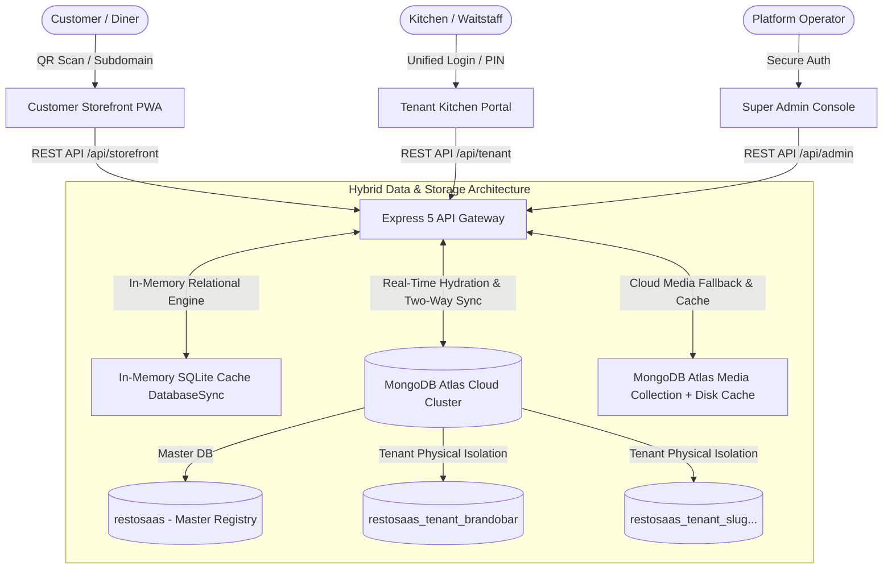

# Dine — Multi-Tenant Restaurant SaaS Platform Suite


**Dine** is a high-performance, cloud-native **React + Express + Node.js + MongoDB Atlas** multi-tenant restaurant platform. Engineered with a hybrid **Database-per-Tenant physical isolation architecture** backed by an **in-memory SQLite acceleration engine**, Dine allows independent food businesses to operate fully branded digital storefronts, QR table ordering, live kitchen display systems (KDS), and Philippine payment gateways (GCash & Maya) from a unified SaaS platform.

---

## 🏗️ Architecture Overview



---

## 🌟 Core System Capabilities

### 1. Hybrid Cloud Multi-Tenancy (Database-per-Tenant)
- **MongoDB Atlas Physical Database Isolation**: Each tenant restaurant is provisioned with its own dedicated MongoDB Atlas database (e.g. `restosaas_tenant_<slug>`). Tenant collections—including `menu_categories`, `menu_items`, `restaurant_tables`, `orders`, `customers`, `staff_members`, and `menu_addons`—are physically partitioned.
- **In-Memory SQLite Acceleration**: High-speed, microsecond-latency query responses using Node.js native `DatabaseSync(':memory:')`. Master data and tenant schemas are hydrated into memory on-demand from Atlas via `mongoHydration.js` and synced bidirectionally via `mongoSync.js`.
- **Cloud Media Persistence & Fallback**: Images (logos, banners, dishes, payment receipts) uploaded to local storage are automatically backed up in MongoDB Atlas `Media` collections. On container restarts or ephemeral hosting environments (like Render), missing media files are seamlessly retrieved from Atlas and restored to the local disk cache.

### 2. Multi-Tenant URL & Subdomain Routing Engine
- **Subdomain Routing**: `http://<subdomain>.localhost:5173` or `<subdomain>.yourdomain.com` (e.g., `http://brandobar.localhost:5173` automatically renders the Brandobar digital menu).
- **Direct Path Routing**:
  - **Customer QR Menu**: `/store/<slug>` or direct `/<slug>` (e.g., `/store/brandobar` or `/brandobar`)
  - **Tenant Kitchen Portal**: `/portal/<slug>` (e.g., `/portal/brandobar`)
  - **Super Admin Console**: `/admin`
  - **Public SaaS Landing Page**: `/`
- **PaaS Hostname Disambiguation**: Intelligently handles cloud subdomains on platforms such as Render (`*.onrender.com`), Vercel (`*.vercel.app`), Netlify, and Railway so hosting service domains are never mistaken for restaurant slugs.

### 3. Kitchen Display System (KDS) & Operations
- **Live Order Workflow**: Real-time kitchen queue tracking orders through `Pending` ➔ `Preparing` ➔ `Ready` ➔ `Completed` / `Cancelled`.
- **Audio Beeper Alert System**: Synthesized audio alerts powered by the HTML5 Web Audio API notify staff immediately when new orders arrive or when orders are marked ready for pickup.
- **Preparation Wait Timers**: Dynamic calculation and display of kitchen wait times based on active tickets and item preparation times.
- **Category-Scoped Menu Add-ons**: Add-on modifiers can be linked specifically to individual categories (e.g., drink upgrades vs. food sides).
- **Interactive QR Table Management**: Generate, download, and print table-specific QR codes with instant dine-in table assignment (`?table=Table+1`).

### 4. Mobile-First Customer Storefront (PWA)
- **Table Dine-In & Takeout**: Support for dine-in QR orders, takeout, takeaway, and pickup.
- **Instant Search & Category Filtering**: Quick keyword lookup and category tabs with animated active indicators.
- **Philippine Payment Gateways**: Built-in payment flows for **GCash**, **Maya**, and Cash with proof-of-payment screenshot upload and reference number verification.
- **iPhone HEIC & Image Compression**: Automatic client-side conversion of iPhone HEIC/HEIF photos and compression to JPEG (`imageCompressor.js`) before upload.
- **Live Order Status Tracking**: Diners receive an interactive digital receipt with live order status updates and countdown timers.

### 5. Super Admin Platform Console
- **Executive Metrics**: Platform overview covering Total Tenants, Active MRR / ARR, Global Order Volume, and Active Users.
- **Automated Tenant Provisioning**: 1-click wizard to spin up a new restaurant with isolated database allocation, storage directory generation, and default owner accounts.
- **Subscription Tier Management**: Configure and toggle pricing tiers (Starter Cafe, Growth Bistro, Pro Restaurant, Enterprise Franchise) with Monthly vs. Yearly pricing switchers.
- **Invoicing & Billing Ledger**: Comprehensive financial audit trail with status tracking and manual settlement verification.
- **Brand & Theme Customization**: Real-time theme picker with persistent color customization (defaults: Neon Cyan `#00C4CC` and Hot Pink `#FF2A85`).
- **Glassmorphic Confirm Dialogs**: Native browser `alert()` and `confirm()` replaced platform-wide with animated glassmorphic modal overlays.

---

## 🛠️ Technology Stack

| Layer | Technology | Details |
| :--- | :--- | :--- |
| **Frontend** | React 18 + Vite | Single Page Application with dynamic client routing |
| **Styling** | Modern Vanilla CSS | Glassmorphism, HSL CSS variables, dark-mode design system |
| **Icons & Audio** | Remix Icon & Web Audio API | Vector iconography and zero-dependency synthesized audio alerts |
| **Backend** | Node.js 20+ / 24 & Express 5 | High-speed REST API with CORS and 50MB payload limits |
| **Primary Database** | MongoDB Atlas | Cloud document store with physical database-per-tenant isolation |
| **Cache Engine** | In-Memory SQLite | Node.js native `DatabaseSync(':memory:')` query engine |
| **Authentication** | JWT + bcryptjs | Role-based access control (Super Admin, Owner, Staff, Customer) |
| **Deployment** | Render & Vercel | Single-service container execution or decoupled static frontends |

---

## 🚀 Getting Started

### Prerequisites
- **Node.js**: `v20.0.0` or higher (Node 24 recommended for native `node:sqlite`)
- **npm**: `v9.0.0` or higher
- **MongoDB Atlas**: Free or dedicated cloud cluster connection string

---

### Installation & Setup

1. **Clone the repository**:
   ```bash
   git clone https://github.com/Chun-taro/Restaurant-MultiTenancy.git
   cd Restaurant-MultiTenancy
   ```

2. **Configure Environment Variables**:
   Create a `.env` file in the project root (or inside `backend/`):
   ```env
   PORT=3000
   NODE_ENV=development

   # MongoDB Atlas Connection String
   MONGODB_URI=mongodb+srv://<username>:<password>@restosaas.6ucox8v.mongodb.net/restosaas?retryWrites=true&w=majority

   # Secrets
   SESSION_SECRET=your-secure-session-secret-here
   JWT_SECRET=your-secure-jwt-secret-here

   # Universal Developer Accounts (Auto-seeded on boot)
   DEV_SUPERADMIN_NAME="RestoSaaS Dev Admin"
   DEV_SUPERADMIN_EMAIL="RestoSaasDev@gmail.com"
   DEV_SUPERADMIN_PASSWORD="restosaasdev@123"

   DEV_OWNER_NAME="Restaurant Dev admin"
   DEV_OWNER_EMAIL="DevOwner@gmail.com"
   DEV_OWNER_PASSWORD="devowner@123"

   DEV_STAFF_NAME="Restaurant Dev Staff"
   DEV_STAFF_EMAIL="DevStaff@gmail.com"
   DEV_STAFF_PASSWORD="devstaff@123"

   DEV_CUSTOMER_NAME="Dev Customer"
   DEV_CUSTOMER_EMAIL="DevCustomer@gmail.com"
   DEV_CUSTOMER_PASSWORD="devcustomer@123"
   ```

3. **Install Dependencies**:
   ```bash
   # From root directory: installs root, backend, and frontend packages
   npm run build
   ```

---

### Running the Application

#### Option 1: Dual Terminals (Recommended for Development)

- **Terminal 1 — Backend API Server**:
  ```bash
  cd backend
  npm run dev
  ```
  *Listens on:* `http://localhost:3000`

- **Terminal 2 — Frontend Dev Server (Vite HMR)**:
  ```bash
  cd frontend
  npm run dev
  ```
  *Listens on:* `http://localhost:5173` *(Proxies `/api` and `/uploads` to port 3000)*

#### Option 2: Unified Production Mode (Render / Docker / Single Process)

Run the full stack from the project root:
```bash
npm start
```
The root `index.js` delegates to Express, which serves the backend REST APIs and delivers the pre-built React application from `frontend/dist`.

---

## 🔑 Default Developer Test Credentials

The system automatically initializes universal developer credentials across all tenants on boot:

| Role | Email / Identifier | Password | Access / Scope |
| :--- | :--- | :--- | :--- |
| **Super Admin** | `RestoSaasDev@gmail.com` *(or `admin@restosaas.com`)* | `restosaasdev@123` *(or `admin123`)* | Global Super Admin Console (`/admin`) |
| **Restaurant Owner** | `DevOwner@gmail.com` | `devowner@123` | Tenant Management & Kitchen Portal (`/portal/:slug`) |
| **Restaurant Staff** | `DevStaff@gmail.com` | `devstaff@123` *(PIN: `1234`)* | Kitchen Queue, Order Status, Tables (`/portal/:slug`) |
| **Customer** | `DevCustomer@gmail.com` | `devcustomer@123` | Mobile Digital Storefront (`/store/:slug`) |

---

## 📡 REST API Structure

| Endpoint Prefix | Description | Authentication |
| :--- | :--- | :--- |
| `GET /api/health` | System health, MongoDB Atlas status, and version | Public |
| `/api/auth/*` | Super Admin authentication and profile lookup | JWT / Dev bypass |
| `/api/dashboard/*` | Platform metrics, revenue aggregates, and tenant statistics | Super Admin JWT |
| `/api/tenants/*` | Tenant provisioning, configuration, suspension, and updates | Super Admin JWT |
| `/api/plans/*` | Subscription tiers, pricing, and feature definitions | Super Admin JWT |
| `/api/billing/*` | Platform invoices, payment histories, and billing ledger | Super Admin JWT |
| `/api/tenant/:restaurantId/*` | Isolated kitchen queue, menus, add-ons, staff, tables | Tenant Owner / Staff |
| `/api/storefront/:slug/*` | Public menu items, active categories, and order placement | Public / Customer |
| `/uploads/*` | Tenant branding media with MongoDB Atlas dynamic fallback | Public |

---

## ☁️ Cloud Deployment Guide

### Deploying to Render
1. Connect your GitHub repository to [Render](https://render.com).
2. Create a new **Web Service** referencing [`render.yaml`](file:///d:/DEv/Restaurant-MultiTenancy/render.yaml):
   - **Environment**: `Node`
   - **Build Command**: `npm run build`
   - **Start Command**: `npm start`
3. Add environment variables:
   - `MONGODB_URI`: Your MongoDB Atlas connection URI
   - `SESSION_SECRET`: Random 32-character string
   - `JWT_SECRET`: Random 32-character string
4. The service will build both the frontend and backend, serving the static frontend from the Express container automatically.

### Deploying Frontend to Vercel (Optional)
If deploying the frontend independently on Vercel:
- **Root Directory**: `frontend`
- The bundled [`vercel.json`](file:///d:/DEv/Restaurant-MultiTenancy/frontend/vercel.json) rewrites all incoming routes to `index.html` to support client-side tenant routing.

---

## 📄 License
This project is licensed under the ISC License. Built according to the **Restaurant SaaS Architecture Proposal**.

